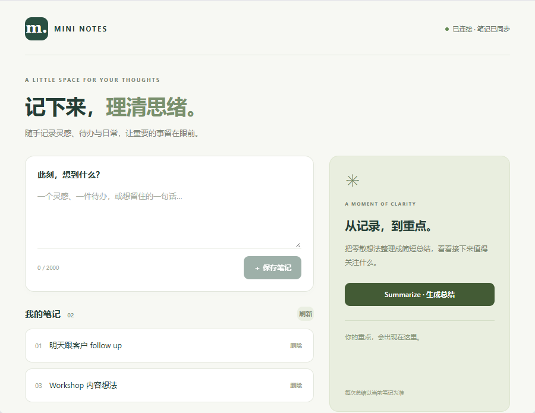

# Mini Notes — Anna App

在 Anna iframe 中创建、查看、删除笔记，并通过本地 Go Executa 向 host 发起 LLM sampling 请求。



## 快速开始

需要 Node.js 22+、npm、Go 1.23+、[uv](https://docs.astral.sh/uv/getting-started/installation/)。本项目验证使用 Node 24.15.0 / Go 1.27.3 / Anna CLI 0.1.61；npm 依赖固定在 package-lock.json。

```sh
npm ci
npm run build
npm run build:tool
npm run validate
npm run dev:ui
```

打开终端显示的 `http://localhost:5180/`。也可以用 `npm run dev` 一次完成构建和启动。

这些命令使用 `anna-app dev --no-llm` 和默认的 legacy in-memory runtime_state，不需要 Anna 登录、真实 LLM key 或数据库。请从 Anna dashboard 打开的 iframe 操作；单独打开 bundle/index.html 不具备宿主环境。

**第一次运行可能需要先缓存 runtime。** CLI 的 Python bridge 启动限时为 8 秒；首次下载超时可执行下面的命令，完成后再启动：

```sh
uvx --from anna-app-runtime-local==0.2.0a30 python -c "import anna_app_runtime_local; print('Anna runtime ready')"
```

## 使用与验收

1. 输入内容并保存：空白输入不可保存；写入成功后输入清空。
2. 查看列表：显示内容和稳定的添加顺序。
3. 删除笔记：storage 写入成功后列表更新，剩余序号不重排，新笔记不复用已删除的序号。
4. 点击“刷新”，或仅刷新 iframe：通过 storage.get 重新读取。不要刷新外层 dashboard 来测试持久性，因为它会创建新的本地 session。
5. 点击 **Summarize**：前端读取当前笔记快照并调用 tools.invoke。

在 `--no-llm` 下，第 5 步预期显示：

```text
[-32603] harness started with --no-llm
```

这是宿主明确关闭 LLM 后的正常结果，不是后端 sampling 实现失败。UI 不会用固定文本伪造总结。后端成功路径用下一节的独立 fixture 测试验证。

本地 legacy runtime_state 仅用于免登录调试。外层 dashboard 刷新或 dev 进程重启后数据不保证保留；生产 Anna storage 可由 APS KV 支撑，两者使用相同 Host API，但本项目不声称验证了真实云端 APS。

## 后端 sampling 测试

```sh
npm run test:sampling
```

该脚本执行真实的 `anna-app executa dev --mock-sampling` 子进程，并断言 summary 与 fixture 的 host 响应一致、stderr 存在 sampling 请求与响应记录。原始命令也可逐项执行：

```sh
npx anna-app executa dev --dir executas/notes-summary --mock-sampling fixtures/sampling-success.jsonl --no-agent --no-image --no-upload
```

这是交互 REPL。也可运行 one-shot（以下参数用单引号包住，适用于 PowerShell 7 与常见 Unix shell）：

```sh
npx anna-app executa dev --dir executas/notes-summary --mock-sampling fixtures/sampling-success.jsonl --no-agent --no-image --no-upload --invoke summarize --args '{"notes":[{"order":1,"content":"明天跟客户 follow up"},{"order":2,"content":"修复登录 bug"},{"order":3,"content":"Workshop 内容想法"}]}' --json
```

fixture 是 host 侧离线测试数据，不是模型真实输出；Tool 中不包含该总结字符串。修改 fixture 返回文本后，测试会验证返回值随之变化。没有 UI tools.invoke mock 替代后端 sampling。

证据位置：

- `test-results/sampling-cli.json`：最终 invoke 结果。
- `test-results/sampling-cli.stderr.log`：`sampling.request`、`sampling.response`，带 invoke_id 与 sampling_id。
- `test-results/protocol.jsonl`：双向原始 JSON-RPC transcript，包括真正的 `sampling/createMessage` 帧。
- `docs/evidence/`：本地实际验收的固定快照及说明。

## 手动协议检查

```sh
npm run test:protocol
```

此脚本通过管道逐帧驱动可执行文件，测试 initialize、describe、invoke，动态接收反向请求并回复它实际产生的 ID，同时验证并发请求关联、错误、超时、持续读取与 EOF。可直接用 `node scripts/test-protocol.mjs <binary-path>` 检查另一个本机 binary。

交互协议的关键帧如下（每个 JSON 对象一行）：

```json
{"jsonrpc":"2.0","id":1,"method":"initialize","params":{"protocolVersion":"2.0","capabilities":{"sampling":{}}}}
{"jsonrpc":"2.0","id":2,"method":"describe"}
{"jsonrpc":"2.0","id":3,"method":"invoke","params":{"tool":"summarize","arguments":{"notes":[{"order":1,"content":"明天跟进客户"}]},"context":{"invoke_id":"manual-3"}}}
```

收到 Tool 的 `sampling/createMessage` 后，保持 stdin 打开，取该请求的 ID 回送：

```json
{
  "jsonrpc": "2.0",
  "id": "sampling:1",
  "result": {
    "role": "assistant",
    "content": { "type": "text", "text": "明天跟进客户。" },
    "model": "manual-fixture"
  }
}
```

这里的 `sampling:1` 只是首条请求示例，实际必须匹配收到的 ID。Tool 随后才会返回 `id:3` 的 invoke 结果。只把 invoke 输入一次就关闭 stdin，无法完成双向 sampling。

仅检查 describe 时，可以使用单向输入。例如 PowerShell 7：

```powershell
'{"jsonrpc":"2.0","id":1,"method":"describe"}' | & '.\executas\notes-summary\bin\notes-summary.exe'
```

stdout 只含 JSON-RPC 帧（响应与反向请求），日志写 stderr，每帧换行并 flush。进程持续读取直到 EOF 或显式 shutdown。`NOTES_SAMPLING_TIMEOUT_MS` 可缩短测试超时，默认 55 秒；不得超过默认值。

## 平台调用链与兼容说明

```text
iframe → AnnaAppRuntime.connect()
       → anna.storage.get/set
       → anna.tools.invoke({tool_id, method:"summarize", args:{notes}})
       → Go Executa invoke
       → reverse sampling/createMessage
       → host LLM / 后端测试 sampling fixture
       → invoke result.data.summary → Host 解包 → UI
```

- **App manifest**：声明窗口、构建后 bundle 入口和 Host API 权限。`ui.bundle.entry: index.html` 相对于 CLI 默认 bundle 根目录，实际文件为构建后的 `bundle/index.html`。
- **Tool manifest**：描述 summarize 的 `parameters[]`、`host_capabilities: ["llm.sample"]` 与 runtime。describe 直接返回此 manifest。
- **工具身份**：本地使用 `tool-local-notes-summary-12345678`，在 App manifest、executa.json、Tool manifest 和前端常量中一致；前端从 Tool manifest 导入 name。`npm run validate` 自动核查。此 ID 只用于本题免登录本地开发；线上发布 Anna Tool 时另需真实服务器身份，本题不要求该流程。
- **Storage / APS KV**：`src/anna/storage.ts` 只通过 get/set 读改写 `mini-notes:v1`；无 localStorage、IndexedDB、文件持久化或自建 HTTP API。
- **Sampling**：单一 stdin reader 将 host 请求与 reverse response 分流；invoke worker 等待 sampling 时 reader 仍能接收响应。metadata 和 context 带关联 invoke_id。只提取 host 返回文本，不使用规则替代总结。
- **Binary archive**：根 manifest.json 描述安装入口与权限，bin/ 内是独立 Go binary，不依赖 Node/Python/Go 解释器。`scripts/run-tool.mjs` 仅是跨平台本地开发启动器，不放入发布包。

已核实 CLI 0.1.61 使用 runtime-local 0.2.0a30，其 UI ExecutaPool 有两处与 standalone runner 不同的行为：

1. UI pool 直接发送 invoke，不发送 initialize。仅本地启动器设置 `NOTES_ALLOW_LEGACY_HARNESS=1` 以支持此路径。直接运行发行 binary 默认仍要求 v2 协商；显式协商为 v1 后，兼容开关也不会开启 sampling。独立后端测试会正常执行 initialize v2。
2. UI pool 把 reverse sampling 映射到宿主的 llm.complete 桥接路径，所以 App manifest 必须声明 `ui.host_api.llm: ["complete"]`。**前端代码从未调用 anna.llm.complete**；该权限用于本地宿主处理 Tool 的 sampling。缺少它会先得到权限错误，无法到达预期的 `--no-llm` 错误。

以上兼容来自实际安装的官方 runtime 行为，未修改官方依赖文件。

## 测试与调用证据

```sh
npm run check
```

运行构建、严格 manifest 验证、笔记逻辑测试、双向协议测试及 standalone mock sampling 测试。

完整 UI 测试需要 Chromium：

```sh
npx playwright install chromium
npm run test:ui
```

它启动真正的 Anna harness，在 iframe 内创建三条笔记、删除第二条、刷新读取、只刷新 iframe、点击 Summarize，验证预期的禁用 LLM 错误。它不会注入 mock summary。

已有 Chrome 时，可在 PowerShell 7 设置 `$env:BROWSER_CHANNEL = 'chrome'` 后运行；也支持 `HARNESS_URL` 指向已启动的本地 harness。默认测试端口为 5189。

查看 `test-results/ui-rpc.jsonl` 中 `ns:storage, method:get/set` 和 `ns:tools, method:invoke`。该文件只保存验收笔记与相关调用结果，不保存 session token。也可以使用 Anna dashboard 的 RPC 日志或 Record 功能观察同样链路。

测试范围包含空输入、稳定序号、并发写入队列、存储写失败后恢复、失败删除不改变已保存数据、损坏数据保护、summary 结果与错误透传。只验证本地单窗口模型，未实现跨窗口冲突合并。

## 二进制打包

自动识别本机 OS / CPU 并生成当前机器可运行的 archive：

```sh
npm run package:executa
npm run verify:archive -- --require-native
```

也可交叉编译：

```sh
npm run package:executa -- --platform darwin-arm64
npm run package:executa -- --platform darwin-x86_64
npm run package:executa -- --platform windows-x86_64
node scripts/collect-release.mjs
```

Go 的 amd64 对应 Anna 的 x86_64。支持的三个平台之外会明确报错。若 Go 未在 PATH，可以设置 GO_BINARY 为 go 可执行文件路径。

```text
dist/
  notes-summary-darwin-arm64.tar.gz
  notes-summary-darwin-x86_64.tar.gz
  notes-summary-windows-x86_64.zip
  *.sha256
  SHA256SUMS.txt
```

每个 archive 的根目录都是：

```text
manifest.json
bin/notes-summary       # macOS：tar 内模式 0755
# 或 bin/notes-summary.exe（Windows）
```

根 manifest 包含 name/version/tools/host_capabilities/runtime.binary.entrypoint/permissions。验证脚本核对 SHA-256、二进制架构、archive 结构与 entrypoint；在相同平台解包并真实执行 describe。不同平台只检查结构与二进制头，不冒称完成了原生运行测试。

## GitHub Actions 发布

`.github/workflows/release.yml` 支持：

- 推送版本 tag，例如 `v0.1.0`。
- Actions → Build and release Executa → Run workflow，输入已存在的版本 tag。

tag 必须匹配 package.json 与 Tool manifest 版本。手动触发同样 checkout 指定 tag，避免发布不同提交。

workflow 使用 macos-15（ARM64）、macos-15-intel（x86_64）、windows-2025（x86_64）分别执行检查、构建、打包、原生解包 smoke test。三个 job 全成功后，汇总 SHA256SUMS 并上传到同一个 GitHub Release；所有文件上传完毕才公开 Release。中间 Actions artifacts 只是传输介质，不是最终交付。

发布资产必须包含三个平台 archive 和 SHA256SUMS.txt。使用内置 GITHUB_TOKEN，Release job 声明 contents: write，不需要在项目中配置个人 PAT。已公开的 Release 不被覆盖；发布新版本请更新版本号及 tag。

当前 GitHub 远程仓库创建、推送、Actions 实际执行与 Release 发布状态见 `docs/evidence/verification.md`。本地交叉编译通过不等于 Actions 已运行。

## 项目结构

```text
src/App.tsx                 UI 与异步操作状态
src/anna/runtime.ts         Anna Runtime 连接
src/anna/storage.ts         Host API 笔记仓储
src/anna/tools.ts           Executa 调用
src/notes/model.ts          笔记数据校验与顺序
executas/notes-summary/     Go 源码、嵌入 manifest、本地发现配置
fixtures/                   host mock sampling fixture
scripts/                    构建、协议测试、CLI 测试、UI 测试、打包与校验
tests/                      笔记与调用逻辑测试
docs/evidence/              已执行验证的证据快照
.github/workflows/          三平台 GitHub Release workflow
bundle/                     前端构建产物（gitignore）
dist/                       二进制 archive（gitignore）
```

源码没有依赖隔壁的示例仓库、机器绝对路径、真实账号或秘密信息。首次 npm / uv 下载依赖需要网络，缓存完成后免登录的本地调试与 mock 测试不需要真实 LLM。

## 官方资料

- [本地开发](https://staging.anna.partners/developers/apps/local-dev.md)
- [App UI SDK](https://staging.anna.partners/developers/apps/app-ui-sdk.md)
- [Storage Host API](https://staging.anna.partners/developers/reference/host-api-storage.md)
- [Tools Host API](https://staging.anna.partners/developers/reference/host-api-tools.md)
- [Executa 协议](https://staging.anna.partners/developers/tools/executa-protocol.md)
- [Sampling](https://staging.anna.partners/developers/tools/executa-sampling.md)
- [Binary Distribution](https://staging.anna.partners/developers/tools/executa-binary.md)
- [参考示例](https://github.com/whtcjdtc2007/anna-executa-examples)

普通文档页面由 JavaScript 渲染；在 URL 后加 `.md` 可获取官方原始 Markdown。此前浏览工具的连接失败已通过本机代理读取 Markdown 解决。
