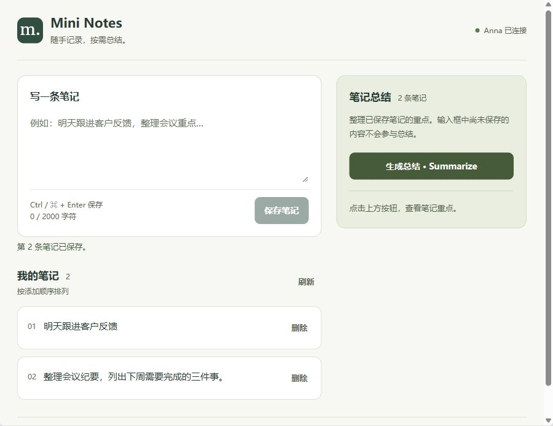
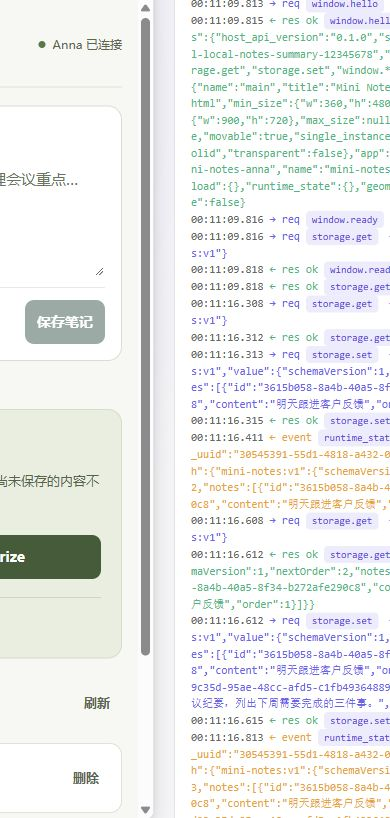

# Mini Notes 界面可用性检查

日期：2026-10-30。对应本地分支 `ui/usability-review`；本次未发布新的 GitHub Release。

## 参考与取舍

- [Simplenote](https://simplenote.com/)：借鉴其“表面简单”的设计原则，把记录与阅读作为主要任务。Mini Notes 按题目要求保留显式保存，没有增加标签、搜索或自动同步。
- [Bear](https://bear.app/)：借鉴清晰的内容分区与克制的视觉层级；不照搬三栏导航、富文本等复杂功能。

原界面的主要问题：大标题和英文装饰挤占输入空间，辅助文字和删除按钮偏小，总结错误出现在全页顶部，删除缺少确认，窄屏总结在整个笔记列表之后。

## 已调整

- 紧凑页头；桌面左侧输入与列表，右侧总结。窄屏按输入、总结、列表排列，让总结入口可发现。
- 正文 15px，主要辅助文字 12–13px；可操作按钮高度至少 44px；保留清晰键盘焦点。
- 空白输入不可保存；支持 Ctrl / Cmd + Enter，中文输入法组合期间不触发；保存完成后清空输入并恢复焦点。
- 删除使用就地确认，默认聚焦取消；支持 Esc 取消，成功后焦点回到列表标题。
- 保存、读取、删除反馈与总结反馈分开；原始技术错误收进“查看详情”。
- 总结只使用已保存笔记；生成过程中可继续输入草稿。笔记改变后清除旧总结并提示重新生成。
- 无模型提示解释当前可做的操作，失败后隐藏不适用的总结占位提示。
- 本地预览提供折叠的会话存储说明，避免把临时调试会话误解成永久保存。
- manifest 声明 desktop / mobile，以便官方 harness 切换响应式预览。

## 本次验证

通过 `npm run build`、`npm run validate`、`npm test`（5 项）、`git diff --check`。

在真实 Anna harness 的独立会话中，通过浏览器实际验证：

1. 空输入和纯空格不能保存；保存后清空输入并恢复焦点。
2. Ctrl + Enter 保存；删除弹出确认且焦点在取消；Esc 取消后数据不变。
3. 确认删除后，重新读取仍然正确；新笔记不复用已删除的序号。
4. `--no-llm` 错误只显示在总结区，输入草稿保留，笔记仍显示；错误后不再显示“点击按钮查看重点”。
5. 900px 桌面与 harness 390px 窄屏布局；窄屏内容宽度与滚动宽度均为 375px（另含滚动条），没有横向溢出，按钮高度均为 44px。
6. harness 切换屏幕形态后，当前会话笔记仍能读回。

`scripts/test-ui.mjs` 已同步新控件名称、删除确认与草稿保留断言；本次 UI 验证使用交互浏览器，未重新运行该自动化脚本。后端协议和 sampling 逻辑未修改，沿用 v0.1.0 的验收记录。

范围限制：未进行真人可用性研究或完整无障碍审计；本次未接入真实 LLM。窄屏是浏览器模拟，未在实体手机中验收。不能据此承诺所有使用情境都完全合理。

## 预览

截图使用独立会话中的示例笔记。

