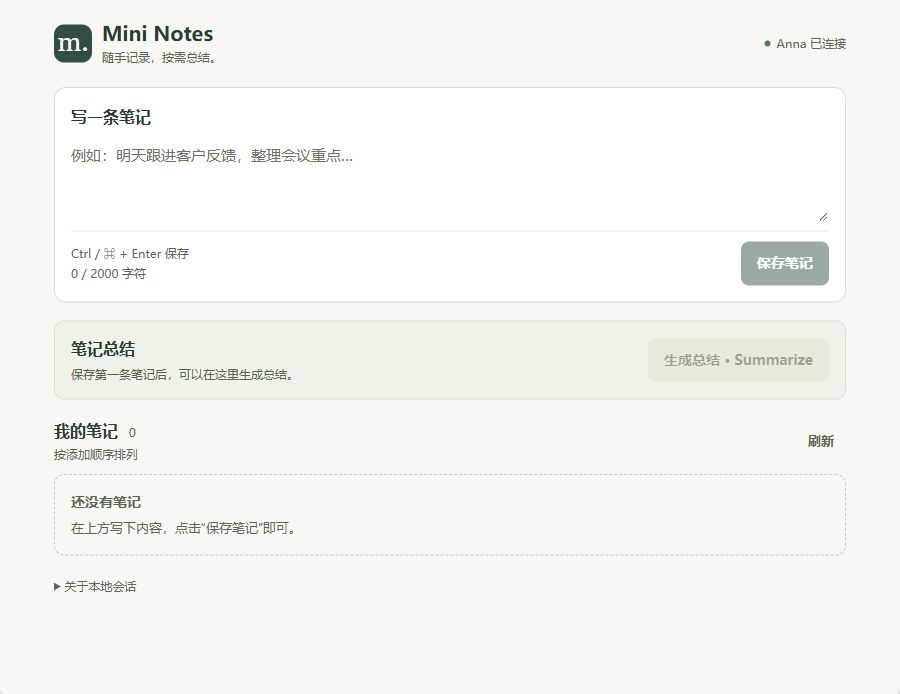

# Mini Notes 最终界面与原题验收

日期：2026-10-30。工作分支：`ui/usability-review`。

本页记录界面收紧阶段的验收。后续已实际执行新增 Playwright 自动化用例，并升级 CI 与最终 archive 测试，最新结果见 [自动化验收升级](AUTOMATION-UPGRADE.md)。

## 最终界面

界面保持单列：输入区 → 总结辅助栏 → 笔记列表。桌面最大内容宽度 840px，窄屏自然缩放。总结无结果时只显示简短说明和操作按钮，有结果、等待或错误时才展开内容。

修正了初版的明显问题：大面积装饰和空白、过重的右侧总结卡片、空页面内层滚动、空列表仍显示“笔记已读取”。保留清晰的文字、44px 操作按钮、删除确认、键盘焦点、Ctrl / Cmd + Enter 保存和草稿保护。

官方 Anna harness 的地址栏、日志、录制按钮属于开发工具，不是应用的功能。它们保留用于题目验收。没有修改官方依赖、隐藏调用证据或用普通 Web 页面替代 Anna iframe。

参考：[Simplenote](https://simplenote.com/) 的简单操作与 [Bear](https://bear.app/) 的内容层级；仅借鉴简洁原则，没有增加题目不要求的富文本、标签、搜索等功能。

## 原始 question.md 对照

| 原题要求                                      | 实现与证据                                                          | 本次结果                                                                                              |
| --------------------------------------------- | ------------------------------------------------------------------- | ----------------------------------------------------------------------------------------------------- |
| 工程化前端、静态 bundle                       | React / TypeScript / Vite，UI、runtime、storage、tools 分层         | `npm run build` 通过                                                                                  |
| manifest 声明及 tool identity 一致            | `manifest.json`、Executa manifest、调用常量、describe               | `npm run validate`，包含 strict 校验，通过                                                            |
| 创建、查看、删除笔记；内容与添加顺序          | `src/App.tsx`、`src/notes/model.ts`                                 | 浏览器创建三条、取消删除、确认删除第二条、刷新读回通过                                                |
| 空输入禁存；保存后清空输入                    | 表单约束、输入处理                                                  | 空白字符不可保存；保存后输入清空并恢复焦点；快捷键通过                                                |
| Anna storage get / set                        | `src/anna/storage.ts`；[本次 Host API 记录](ui-review/host-api.txt) | 创建和删除均产生真实 get / set；重新挂载 iframe 后读回 1、3 两条笔记                                  |
| 默认无登录 legacy runtime_state               | 原生 `anna-app dev --no-llm`                                        | 在独立 session 验证；不承诺刷新外层 dashboard 后仍保留                                                |
| Summarize 调用本地 Executa                    | `src/anna/tools.ts`，通过 `anna.tools.invoke`                       | 真实 tools.invoke 参数只含已保存笔记；草稿未发送                                                      |
| `--no-llm` 预期错误                           | 总结区展开“查看详情”                                                | 返回 `[-32603] harness started with --no-llm`；笔记和草稿保留                                         |
| Tool 反向 sampling RPC                        | Go Executa；`scripts/test-protocol.mjs`                             | v2 协商、describe、reverse RPC、并发关联、错误、超时、EOF、stdout 纯净性通过                          |
| 官方 mock sampling 单独验证                   | `scripts/test-sampling.mjs`、fixtures                               | `anna-app executa dev --mock-sampling` 通过，记录 sampling.request / response                         |
| 三平台原生二进制 archive                      | `scripts/package-executa.mjs`、`scripts/verify-archive.mjs`         | 三个平台均打包并通过 manifest、结构、架构、权限、校验和验证；Windows 解包后实际执行 describe 通过     |
| GitHub Release workflow                       | `.github/workflows/release.yml`                                     | 已审阅：三平台 matrix、check、打包、原生 smoke、Release assets 上传均存在；本次没有新建或覆盖 Release |
| README 安装、构建、调试、协议、打包、证据说明 | `README.md`                                                         | 已同步最终 UI 与本次验收说明                                                                          |

此前 v0.1.0 的三平台发布结果保留在 [GitHub Release](https://github.com/Jandersway/mini-notes-anna/releases/tag/v0.1.0)；本次没有修改 Executa 源码、协议或发布 workflow。本机无法执行 macOS 二进制，macOS 原生运行验证由对应 CI runner 完成。

## 本次执行过的检查

- `npm run check`：前端构建、严格校验、5 项基础测试、协议测试、官方 mock sampling 均通过。
- `npm run package:executa` 与 `npm run verify:archive -- --require-native`：Windows 通过。
- `npm run package:executa -- --platform darwin-arm64` 和对应 verify：通过。
- `npm run package:executa -- --platform darwin-x86_64` 和对应 verify：通过。
- `git diff --check`：通过。
- 实际浏览器检查：桌面 / 窄屏空状态、空白输入、创建、快捷键、焦点、删除取消 / 确认、重新读取、iframe 重新挂载、tools.invoke 错误、草稿保护、长连续文本换行。

几何检查使用官方默认窗口，未人为拉高 iframe 掩盖滚动：桌面内容宽度 900px，滚动宽度 900px，空状态及两条短笔记时高度均为 694px，无额外滚动；窄屏空状态宽度 390px、高度 818px，无横向或纵向溢出；长文本下内容宽度与滚动宽度均为 375px（另有纵向滚动条）。内容多时保留正常纵向滚动。

`test:ui` 的可复现脚本也已更新：增加空状态不溢出断言，改用官方 Mobile 切换，不再修改 iframe 高度制造截图。本轮使用交互浏览器完成 UI 验证，未重新执行该 Playwright 脚本。

本次未接入真实 LLM、真实云端 APS 或 Anna 账号，符合原题“不要求”的范围；不把 fixture 结果伪装成真实模型输出。没有进行真人可用性研究或实体手机验收。

## 最新截图

截图仅包含独立测试 session 的示例笔记。

